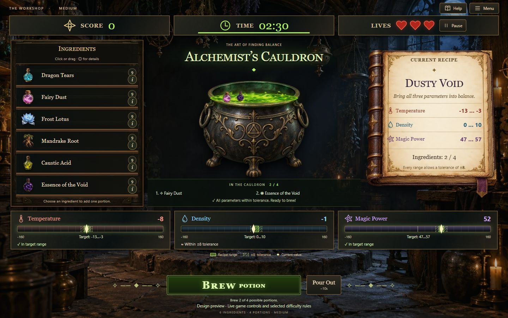

# Alchemist's Cauldron

A TypeScript browser game about combining ingredients, managing reactions and matching three recipe ranges before time, lives or stock run out.

Built for the [RS School assignment](https://github.com/rolling-scopes-school/qualifying-stage/blob/main/tasks/game-alchemists-cauldron/README.md).

## Current scope

The local implementation includes Level 1 gameplay and the Level 2/3 features: difficulty selection, save/continue, per-difficulty Top-10, mouse drag-and-drop, ingredient tooltips, chemical reactions, Pour Out, shortcuts and CSS visual feedback. See the [requirements audit](docs/requirements-audit.md) for implementation details and verification limits.

The [public deployment](https://romasho.github.io/alchemists-cauldron/) publishes the latest `story-3` build after the quality checks and production build pass.



[Mobile interface](docs/workshop-mobile.png) · [Hard mode](docs/workshop-wide.png) · [Artwork layers and prompts](docs/visual-style.md)

## How to play

1. Use **Menu** to choose Easy, Medium or Hard, then **Start Game**. The start screen has an empty shelf and cauldron and zero statistics.
2. Click or drag an ingredient into the cauldron. Its stock is spent immediately. A full cauldron blocks adding; an empty stock slot cannot be focused or dragged.
3. Cards show the ingredient picture, name and stock. Hover or focus to see signed Temperature, Density and Magic Power values; on a phone use the separate **i** button. Opening details does not add a portion.
4. Watch the totals, exact target zones, hatched tolerance zones and text statuses. Enabled reactions change the totals and may spend time or lives. Effects are recomputed from the current mixture; one-time penalties fire only when a combination becomes active.
5. **Brew** checks all three parameters. Success awards points and bonus time capped at the starting time; failure costs one life. Both outcomes consume the mixture. **Pour Out** clears it for 10 seconds without refunding stock or losing a life.
6. **Pause** hides the complete field, including scales and actions. Switching tabs also pauses. **Continue Game** restores a valid unfinished save on pause after reload. **Exit to Menu** clears that save. Corrupt/unavailable storage never crashes the game.
7. Time, lives or an empty shelf plus empty cauldron finish the run. Save qualifying results under a 2–15 character name. Each difficulty has its own Top-10; the table shows difficulty and date. Clearing a board requires an in-app confirmation.

| Setting               | Easy       | Medium                | Hard                                |
| --------------------- | ---------- | --------------------- | ----------------------------------- |
| Shelf / capacity      | 4 / 4      | 6 / 4                 | 8 / 5                               |
| Starting time / lives | 180s / 5   | 150s / 3              | 150s / 3                            |
| Tolerance             | ±12        | ±8                    | ±5                                  |
| Points / bonus time   | 100 / +15s | 200 / +10s            | 300 / +5s                           |
| Enabled reactions     | None       | Bubbling, Solar Frost | Bubbling, Solar Frost, Volatile Mix |

During play, **1–8** add ingredients, **B** brews, **O** pours out and **P** pauses. Shortcuts are ignored in text fields, menus and dialogs. Native Enter/Space operate focused controls; the pause dialog focuses Resume. All decorative movement respects reduced motion.

On phones the recipe and parameters come before ingredients and cauldron. Brew and Pour Out remain outside the scrolling scene. The workshop background fills the viewport even beyond the control container. Runs and records stay in this browser.

## Requirements and development

Use Node.js 24 LTS and npm 11. The Node major version is recorded in `.nvmrc`.

```sh
npm ci
npm run dev
```

Open the local URL printed by Vite (normally <http://localhost:5173>).
The page uses TypeScript and CSS with no runtime libraries or frameworks.
Vite and the quality tools are development dependencies only.

| Command                | Purpose                                                        |
| ---------------------- | -------------------------------------------------------------- |
| `npm run dev`          | Start the development server with hot updates                  |
| `npm run build`        | Typecheck and build production files into `dist/`              |
| `npm run preview`      | Serve the production build locally                             |
| `npm run typecheck`    | Check browser and tooling TypeScript without emitting files    |
| `npm run lint`         | Run ESLint; warnings also fail the check                       |
| `npm run lint:fix`     | Apply available ESLint fixes                                   |
| `npm run format`       | Format supported project files with Prettier                   |
| `npm run format:check` | Check formatting without changing files                        |
| `npm run test:tooling` | Test commit-message validation using Node's built-in runner    |
| `npm run test:game`    | Test difficulty, reactions, timer, stock, save and leaderboard |
| `npm run check`        | Run typecheck, lint, formatting, tooling and game tests        |

Vite uses a relative asset base so `dist/` can be hosted at a domain root or under
a repository subpath. Source SVG imports are included in the production build.

## Folder structure

```text
.github/
  pull_request_template.md
  workflows/quality.yml
.husky/
  commit-msg
  pre-push
scripts/
  validate-commit-message.ts
  validate-commit-message.test.ts
src/
  assets/       # Individual SVG icons and other static assets
  data/         # Ingredient, recipe and difficulty definitions
  logic/        # Pure game rules and calculations, without DOM access
  state/        # Game state and transitions
  storage/      # Validated browser persistence and leaderboard access
  styles/       # Global styles and responsive layout
  ui/           # DOM rendering and user interactions
  main.ts       # Application entry point
```

The domain folders contain data, pure rules, state transitions and persistence.
Keep rendering in `ui/`; game logic must not depend on the DOM, and storage
validation belongs in `storage/`.

## Git workflow

Follow the [RS School Git convention](https://rs.school/docs/git-convention)
and the assignment's story workflow:

1. Create `story-1` from `master` (or `main` in a new clone).
2. Create a feature branch from `story-1` for each task or related task group.
3. Make small commits, open a feature PR into `story-1`, and merge that PR.
4. Open the final `story-1` PR into the original base branch and leave it unmerged
   for Cross-Check. Submit that PR URL through RS App.

Use lowercase Conventional Commit types and imperative English descriptions:

```text
chore: initialize game repository
build: configure vite and strict typescript
feat(ui): add setup screen
fix(storage): handle invalid saved data
```

Husky installs during `npm ci` / `npm install` through the `prepare` script.
`commit-msg` rejects malformed Conventional Commit headers. `pre-push` runs
ESLint and Prettier and stops the push if either fails. Git must be installed;
run the npm commands inside a real clone to enable hooks.

The PR template follows the [official RS School structure](https://rs.school/docs/mentoring/pull-request-review-process#pull-request-requirements-pr):
task, screenshot, deployment, completion/deadline dates, and scored self-check.
Fill the actual course deadline from RS App; it is not specified in the task.

GitHub Actions repeats the quality checks and production build for pushes and PRs.
The deployment workflow publishes the checked `story-3` build to GitHub Pages.
The final story PR stays open while the story build remains publicly available.
For subsequent levels, create `story-2` from `story-1` and `story-3` from `story-2`, targeting each final unmerged PR at the previous story branch.

## Precondition 1 self-check

| Task         | Implementation                                                    | Points |
| ------------ | ----------------------------------------------------------------- | ------ |
| PRE-QS-1-1-1 | Repository, README, ignore rules, dependency lockfile             | 10     |
| PRE-QS-1-1-2 | Domain folders with documented responsibilities                   | 10     |
| PRE-QS-1-1-3 | Official RS School PR template adapted to this story              | 5      |
| PRE-QS-1-2-1 | Vite development server, production build, bundled SVG            | 10     |
| PRE-QS-1-2-2 | Strict TypeScript, checked indexed access and optional properties | 5      |
| PRE-QS-1-2-3 | Typed ESLint checks; explicit `any` and console output prohibited | 5      |
| PRE-QS-1-2-4 | Prettier configuration and format/check commands                  | 5      |
| PRE-QS-1-2-5 | Husky commit validation and pre-push lint/format checks           | 8      |

See the [full Precondition 1 criteria](https://github.com/rolling-scopes-school/qualifying-stage/blob/main/tasks/game-alchemists-cauldron/precondition-user-story.md)
and [common requirements](https://github.com/rolling-scopes-school/qualifying-stage/blob/main/tasks/game-alchemists-cauldron/common-requirements.md).
