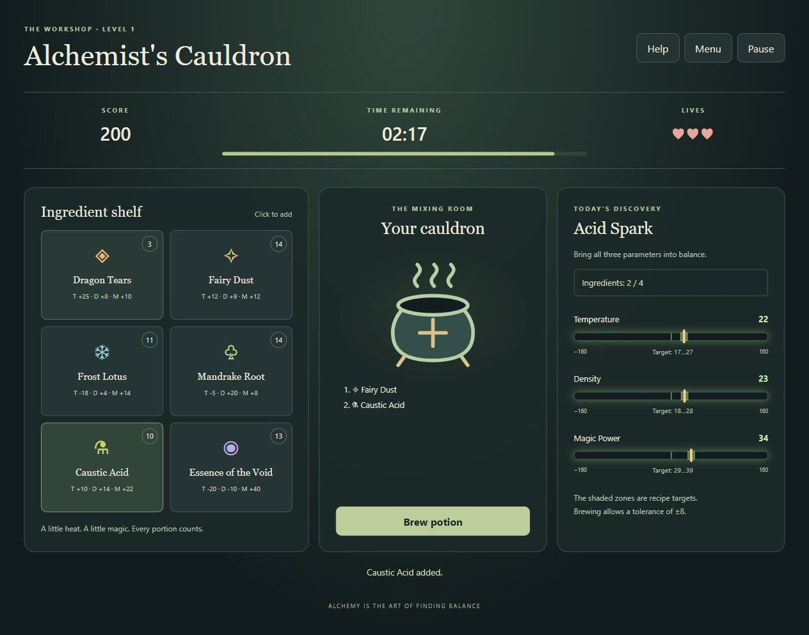

# Alchemist's Cauldron

A browser game about mixing ingredients to match a potion's temperature, density,
and magic power before time or lives run out.

Built for the [RS School assignment](https://github.com/rolling-scopes-school/qualifying-stage/blob/main/tasks/game-alchemists-cauldron/README.md).

## Current scope

Precondition 1 and all Level 1 stories (US 1.1–1.6) are implemented.
Level 1 uses the fixed Medium rules: six ingredients, four portions per cauldron,
150 seconds, three lives, ±8 brew tolerance, 200 points and up to 10 bonus seconds.
The source includes the full eight-ingredient catalogue and all twenty recipes;
only Medium recipes are selected in Level 1. Levels 2 and 3 are not implemented.

[Public deployment](https://romasho.github.io/alchemists-cauldron/) (updated when changes reach `story-1`).



[Mobile gameplay at 375 px](docs/level-1-mobile.png)

In the finished game, players add limited ingredients to a cauldron and try to
match three recipe ranges before time or lives run out.

| Stage          | Scope                                                                      | Points |
| -------------- | -------------------------------------------------------------------------- | ------ |
| Precondition 1 | Repository, structure, bundler, TypeScript, linting, formatting, Git hooks | 58     |
| Level 1        | Shelf, cauldron, parameter bars, brewing, timer, pause, leaderboard        | 170    |
| Level 2        | Difficulty selection, save and continue                                    | 50     |
| Level 3        | Drag and drop, tooltips, reactions, Pour Out, effects, shortcuts           | 115    |

Shared requirements add 30 points at Level 1. The complete assignment is worth
393 points.

## How to play

1. Click **Start Game**. Each ingredient receives 2–15 portions.
2. Click ingredient cards to add up to four portions, in order. T, D and M on each
   card mean Temperature, Density and Magic Power. The bars show signed sums,
   target zones and a moving marker; green means inside the exact recipe range.
3. Click **Brew potion** to check all three sums with ±8 tolerance. Success awards
   200 points, adds 10 seconds (maximum 150), and selects a random Medium recipe.
   Failure loses one life. Both outcomes empty the cauldron and spend the portions.
4. **Pause** freezes the timer and hides the play field. **Resume** continues;
   **Exit to Menu** abandons the run. Switching to another tab also pauses.
5. Time, lives or exhausted ingredients end the run. A final mixture can still
   be brewed after the shelf is exhausted. **Play again** starts with new stock.
6. Qualifying results can be saved to the local Top-10 with a 2–15 character name
   using letters, digits, spaces, `_` or `-`. Equal scores keep earlier results
   first. Open the board from **Menu** or **Game Over**; clearing it requires an
   in-app confirmation. Storage errors show feedback and never stop gameplay.

**Help** explains the rules. Controls use native buttons and support keyboard
focus. Layouts adapt from 375 px to 1920 px; reduced motion is respected.
Leaderboard data stays in this browser. Runs are not saved across reloads in Level 1.

## Requirements and development

Use Node.js 24 LTS and npm 11. The Node major version is recorded in `.nvmrc`.

```sh
npm ci
npm run dev
```

Open the local URL printed by Vite (normally <http://localhost:5173>).
The page uses TypeScript and CSS with no runtime libraries or frameworks.
Vite and the quality tools are development dependencies only.

| Command                | Purpose                                                      |
| ---------------------- | ------------------------------------------------------------ |
| `npm run dev`          | Start the development server with hot updates                |
| `npm run build`        | Typecheck and build production files into `dist/`            |
| `npm run preview`      | Serve the production build locally                           |
| `npm run typecheck`    | Check browser and tooling TypeScript without emitting files  |
| `npm run lint`         | Run ESLint; warnings also fail the check                     |
| `npm run lint:fix`     | Apply available ESLint fixes                                 |
| `npm run format`       | Format supported project files with Prettier                 |
| `npm run format:check` | Check formatting without changing files                      |
| `npm run test:tooling` | Test commit-message validation using Node's built-in runner  |
| `npm run test:game`    | Test game rules, timer, pause, stock and leaderboard storage |
| `npm run check`        | Run typecheck, lint, formatting and tooling tests            |

Vite uses a relative asset base so `dist/` can be hosted at a domain root or under
a repository subpath. Source SVG imports are included in the production build.

## Folder structure

```text
.github/
  pull_request_template.md
  workflows/quality.yml
.husky/
  commit-msg
  pre-push
scripts/
  validate-commit-message.ts
  validate-commit-message.test.ts
src/
  assets/       # Individual SVG icons and other static assets
  data/         # Ingredient, recipe and difficulty definitions
  logic/        # Pure game rules and calculations, without DOM access
  state/        # Game state and transitions
  storage/      # Validated browser persistence and leaderboard access
  styles/       # Global styles and responsive layout
  ui/           # DOM rendering and user interactions
  main.ts       # Application entry point
```

The domain folders contain data, pure rules, state transitions and persistence.
Keep rendering in `ui/`; game logic must not depend on the DOM, and storage
validation belongs in `storage/`.

## Git workflow

Follow the [RS School Git convention](https://rs.school/docs/git-convention)
and the assignment's story workflow:

1. Create `story-1` from `master` (or `main` in a new clone).
2. Create a feature branch from `story-1` for each task or related task group.
3. Make small commits, open a feature PR into `story-1`, and merge that PR.
4. Open the final `story-1` PR into the original base branch and leave it unmerged
   for Cross-Check. Submit that PR URL through RS App.

Use lowercase Conventional Commit types and imperative English descriptions:

```text
chore: initialize game repository
build: configure vite and strict typescript
feat(ui): add setup screen
fix(storage): handle invalid saved data
```

Husky installs during `npm ci` / `npm install` through the `prepare` script.
`commit-msg` rejects malformed Conventional Commit headers. `pre-push` runs
ESLint and Prettier and stops the push if either fails. Git must be installed;
run the npm commands inside a real clone to enable hooks.

The PR template follows the [official RS School structure](https://rs.school/docs/mentoring/pull-request-review-process#pull-request-requirements-pr):
task, screenshot, deployment, completion/deadline dates, and scored self-check.
Fill the actual course deadline from RS App; it is not specified in the task.

GitHub Actions repeats the quality checks and production build for pushes and PRs.
The deployment workflow publishes the checked `story-1` build to GitHub Pages.
The final story PR stays open while the story build remains publicly available.

## Precondition 1 self-check

| Task         | Implementation                                                    | Points |
| ------------ | ----------------------------------------------------------------- | ------ |
| PRE-QS-1-1-1 | Repository, README, ignore rules, dependency lockfile             | 10     |
| PRE-QS-1-1-2 | Domain folders with documented responsibilities                   | 10     |
| PRE-QS-1-1-3 | Official RS School PR template adapted to this story              | 5      |
| PRE-QS-1-2-1 | Vite development server, production build, bundled SVG            | 10     |
| PRE-QS-1-2-2 | Strict TypeScript, checked indexed access and optional properties | 5      |
| PRE-QS-1-2-3 | Typed ESLint checks; explicit `any` and console output prohibited | 5      |
| PRE-QS-1-2-4 | Prettier configuration and format/check commands                  | 5      |
| PRE-QS-1-2-5 | Husky commit validation and pre-push lint/format checks           | 8      |

See the [full Precondition 1 criteria](https://github.com/rolling-scopes-school/qualifying-stage/blob/main/tasks/game-alchemists-cauldron/precondition-user-story.md)
and [common requirements](https://github.com/rolling-scopes-school/qualifying-stage/blob/main/tasks/game-alchemists-cauldron/common-requirements.md).
