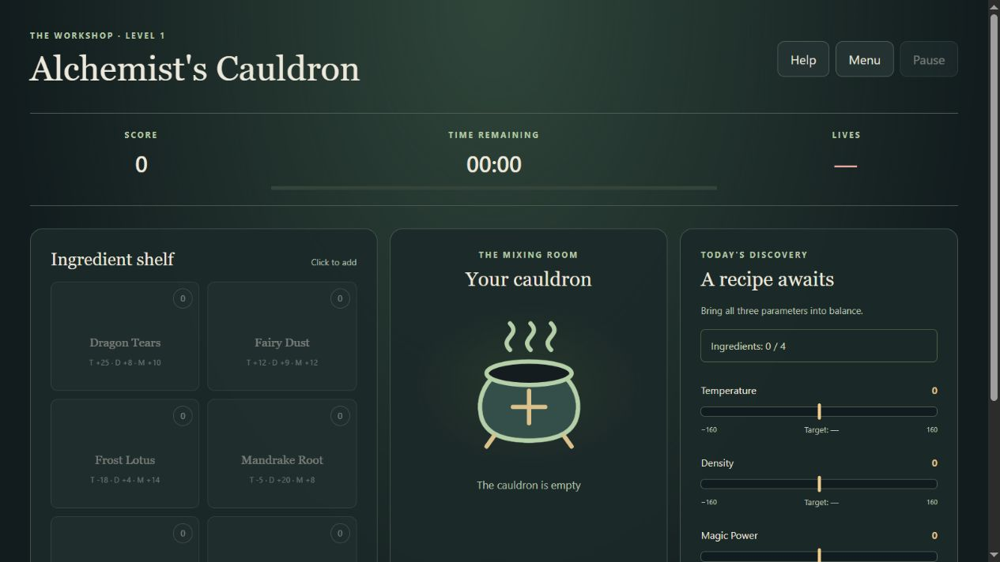
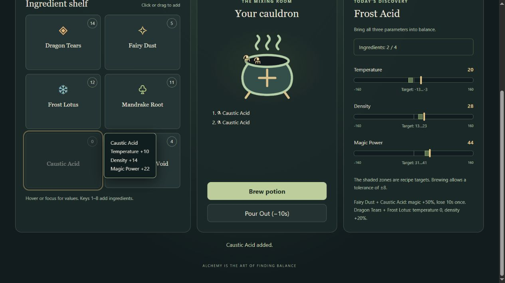

# Проверка соответствия Story 3

Дата: 24.10.2026. Результат: функциональность Level 3 в ветке реализована, но сдача пока не полностью соответствует требованиям.

## Что проверено

- Ветка `story-3`, коммит `46239c64acfd20b00386471af9d7a78172ecaef2`, и открытый [PR #8](https://github.com/romasho/alchemists-cauldron/pull/8) в `story-2`.
- Текущее рабочее дерево: выбрана `story-1`, поверх неё находятся незакоммиченные изменения уровней 2–3 и нового интерфейса. Это другая версия, чем в PR #8.
- [Публичная игра](https://romasho.github.io/alchemists-cauldron/): непосредственно открыта в браузере, отображает `THE WORKSHOP · LEVEL 1`.
- Story 3 экспортирована во временную папку, отдельно проверена и собрана без переключения ветки и изменения пользовательских исходников. Её production-сборка проверена через локальный preview.

Источники: [общие требования](https://github.com/rolling-scopes-school/qualifying-stage/blob/main/tasks/game-alchemists-cauldron/common-requirements.md), [таблицы и описание игры](https://github.com/rolling-scopes-school/qualifying-stage/blob/main/tasks/game-alchemists-cauldron/README.md), связанные US 1.1–1.6, 2.1–2.2 и 3.1–3.6.

## Найденные несоответствия

### 1. Высокий приоритет: по публичной ссылке опубликован Level 1

На опубликованной странице нет интерфейса Level 3: виден заголовок Level 1, параметры ингредиентов находятся на карточках. Это непосредственно подтверждено браузером. Поэтому наличие готового кода в PR не даёт проверяющему публичную версию Story 3.

Причина в конфигурации: `.github/workflows/deploy.yml:5` запускает деплой при push только в `story-1`; эта же конфигурация присутствует в `story-3`. Для сдачи нужна публикация проверенной сборки Story 3. Финальный PR при этом должен остаться открытым.

### 2. Средний приоритет: пустой ингредиент остаётся в порядке Tab в Story 3

Место: [src/ui/game.ts:261–265 в проверенном коммите](https://github.com/romasho/alchemists-cauldron/blob/46239c64acfd20b00386471af9d7a78172ecaef2/src/ui/game.ts#L261).

В активной игре устанавливается `card.disabled = !playing`, независимо от запаса. `aria-disabled` сообщает состояние вспомогательным технологиям, но само по себе не исключает кнопку из клавиатурного фокуса.

Воспроизведение: у Caustic Acid было 2 порции; добавить обе, нажать Tab, затем Shift+Tab. Фокус возвращается на Caustic Acid с запасом 0, и открывается tooltip. Требование к пустому слоту запрещает фокус. Добавление и перетаскивание при этом корректно блокируются.

Исправление: отключать кнопку при нулевом запасе. В текущем рабочем дереве это уже сделано в `src/ui/game.ts`, в `renderShelf`, но этих изменений нет в проверенном PR.

### 3. Средний приоритет: у финального PR #8 пустое описание

Через GitHub проверены состояние и метаданные PR: он открыт, не смержен, направлен из `story-3` в `story-2`; поле body пустое. Направление и состояние правильные, оформление не завершено.

Не заполнены предусмотренные шаблоном `.github/pull_request_template.md` ссылка на задание, скриншот, deployment, даты и самооценка. Перед сдачей нужно заполнить описание под фактическую версию Story 3. Общие требования предусматривают штраф за несоблюдение стиля PR; точное решение принимает проверяющий.

### 4. Требует внимания: история разработки Story 3 не соответствует заданному workflow

В `story-2..story-3` один прямой коммит `46239c6`, добавляющий Level 3. Среди всех восьми PR репозитория нет task PR из feature-ветки в `story-3`. Требования предусматривают работу через feature-ветки и task PR, затем отдельный финальный PR. Для Story 3 подтверждён только финальный PR #8.

Это замечание к процессу сдачи, не к работоспособности игры. Проверка не переписывала историю и не создавала PR.

## Матрица Level 3

| Требование          | Результат для `story-3`                                                                                                                                                                                                                                     |
| ------------------- | ----------------------------------------------------------------------------------------------------------------------------------------------------------------------------------------------------------------------------------------------------------- |
| US 3.1, drag & drop | HTML5-события, подсветка, общий путь добавления, проверки паузы/вместимости/запаса присутствуют. Реальный перенос Dragon Tears в браузере уменьшил запас 14 → 13 и увеличил смесь 2 → 3.                                                                    |
| US 3.2, tooltip     | Базовые значения вынесены с карточек; знаки, hover/focus, позиционирование у краёв, скрытие при паузе присутствуют. Найден отдельный дефект фокуса пустого слота, описанный выше.                                                                           |
| US 3.3, реакции     | Типизированный массив; Easy 0, Medium 2, Hard 3. Пересчёт из текущего списка и однократные штрафы при активации покрыты тестами. Выбранные Bubbling, Solar Frost и Volatile Mix соответствуют таблице. Все 15 одновременно включать не требуется.           |
| US 3.4, Pour Out    | Кнопка, очистка, −10 секунд, сохранение жизней/очков/рецепта, отсутствие возврата запаса и запрет для пустой смеси проверены кодом и тестами. Кнопка также проверена в браузере.                                                                            |
| US 3.5, эффекты     | Есть CSS-анимации успеха, взрыва, тряски и плавающих ингредиентов; плавное движение маркеров. Декоративных JS-таймеров не найдено. Визуальная оценка всех фаз анимации по кадрам не выполнялась.                                                            |
| US 3.6, клавиатура  | Единый обработчик с проверками статуса, диалога и текстового ввода. 1–8, B, C, P/Escape в ветке; обычные Enter/Space для кнопок. В рабочем дереве Pour Out назначен на O; конкретная буква заданием не закреплена. Пауза с клавиатуры проверена в браузере. |

## Накопительные требования уровней 1–2 и общие правила

| Группа                     | Результат                                                                                                                                                                                                                         |
| -------------------------- | --------------------------------------------------------------------------------------------------------------------------------------------------------------------------------------------------------------------------------- |
| Каталог и рецепты          | 8 ингредиентов и 20 рецептов; данные и выбор сложности соответствуют таблицам.                                                                                                                                                    |
| Запас и котёл              | Генерация 2–15, расход, порядок, вместимость и завершение при пустой полке и котле проверяются тестами. Исключение — клавиатурный фокус пустого слота в ветке.                                                                    |
| Варка                      | Допуски, награда, ограничение бонусного времени, расход порций и потеря жизни проверяются тестами.                                                                                                                                |
| Таймер и пауза             | Время вычисляется по timestamps; есть порог срочности, блокировка действий и скрытие поля. Обработчик hidden-tab pause присутствует.                                                                                              |
| Сложность                  | Все числовые настройки Easy/Medium/Hard находятся в общей конфигурации и покрыты тестами.                                                                                                                                         |
| Save / Continue            | Валидатор, localStorage, восстановление на паузе, очистка и обработка повреждённых данных покрыты тестами. В текущем рабочем дереве дополнительно проверены reload → Continue → Resume с сохранёнными рецептом, смесью и запасом. |
| Top-10                     | Отдельные списки по сложности, сортировка, даты, имена, обработка ошибок хранения и пользовательский диалог очистки реализованы. Запись реальных результатов и очистка пользовательских таблиц в UI не выполнялись.               |
| Технические ограничения    | TypeScript; runtime-библиотек и фреймворков нет; explicit any, console.log, alert и confirm в игровом коде не найдены. Логика отделена от DOM. Графика состоит из отдельных элементов.                                            |
| Инструменты и документация | Strict TypeScript, ESLint, Prettier, Husky, README и PR-шаблон присутствуют. README описывает управление и запуск.                                                                                                                |
| Ветки и финальный PR       | Цепочка story-1 → story-2 → story-3 и открытый story-3 → story-2 PR существуют. Замечания к task PR и оформлению приведены выше.                                                                                                  |

## Результаты запуска

| Проверка         | Текущее рабочее дерево | Отдельная копия `story-3` |
| ---------------- | ---------------------- | ------------------------- |
| TypeScript       | Пройдено               | Пройдено                  |
| ESLint           | Пройдено               | Пройдено                  |
| Prettier         | Пройдено               | Пройдено                  |
| Tooling tests    | 2/2                    | 2/2                       |
| Game tests       | 17/17                  | 19/19                     |
| Production build | Пройдено               | Пройдено                  |

Первый запуск внутри песочницы был заблокирован `spawn EPERM`. Повтор с разрешённым доступом прошёл; это ограничение среды, не дефект приложения.

## Ограничения вывода

- Полный диапазон 375–1920 px в этом аудите повторно не прогонялся. В репозитории есть более ранние screenshots и `layout-audit.json`, но они не заменяют свежую проверку точной сдаваемой сборки.
- Отдельный запуск именно в последней Google Chrome и тест на физическом touch-устройстве не выполнялись. Проверки UI проведены во встроенном браузере; touch drag необязателен.
- Факт отправки ссылки в RS App и соблюдение дедлайна по доступным данным не подтверждены.
- Проверки функций из тестов не означают, что каждый сценарий был отдельно повторён вручную в UI.
- Итоговый балл 393/393 не подтверждён: есть воспроизведённые несоответствия, проблема публикации и непроверенные условия сдачи.

Исходники, ветки, коммиты, PR и deployment не изменялись. Добавлены только этот отчёт и два скриншота проверки.
